# Atividade-Individual---PI
<div align="center">



<br/>


<br/>


</div>

---

## 🟥 Sobre o projeto

O **Roblox** é uma plataforma on-line em que os próprios usuários criam e publicam suas experiências (jogos). Além de jogar, as pessoas conversam, formam grupos e fazem amizades. Muitos jogadores passam anos construindo uma história ali, mas essa trajetória fica espalhada e se perde com o tempo.

O **Minha Jornada no Roblox** é um website que, a partir do ID de um jogador, busca dados públicos da plataforma (emblemas, jogos e histórico) e os transforma em uma **linha do tempo** e em **indicadores visuais**.

> 💭 Não é um produto comercial. É um estudo pessoal com utilidade real: ajudar um jogador a revisitar a própria jornada, descobrir quais jogos marcaram cada fase e entender como os seus gostos mudaram ao longo dos anos.

## 🟥 Motivação

Jogo Roblox desde **2017**. O jogo foi uma das partes mais aguardadas do meu dia, um lugar onde fiz amizades on-line e onde aprendi muito mais do que parece: o inglês, conversando com jogadores de outros países, além da criatividade e do raciocínio lógico. Escolhi o tema por representar uma parte importante da minha história.

## 🟥 Funcionalidades planejadas

- [ ] 🏠 Página inicial apresentando o projeto
- [ ] 🔐 Cadastro e login, com validação dos formulários em JavaScript
- [ ] 🆔 Vínculo do usuário a um ID do Roblox
- [ ] 🏅 Consulta de dados públicos do jogador (emblemas e jogos)
- [ ] 🕹️ Linha do tempo da trajetória na plataforma
- [ ] 📊 Dashboard com indicadores (emblemas por ano, jogos com mais conquistas, primeiro jogo registrado)

> [!NOTE]
> O uso de dados externos do Roblox depende da aprovação do professor e das configurações de privacidade de cada conta. Caso não seja possível, os dados serão cadastrados manualmente no site.

## 🟥 Tecnologias

| Camada | Tecnologia |
|:--|:--|
| 🎨 Front-end | HTML, CSS e JavaScript |
| ⚙️ Back-end | Node.js (API) |
| 🗄️ Banco de dados | MySQL, em uma máquina virtual Linux |
| 📈 Gráficos | Chart.js |
| 🗂️ Organização | Trello e Git/GitHub |

<details>
<summary><b>📚 Disciplinas aplicadas</b> (clique para abrir)</summary>
<br/>

| Disciplina | Aplicação no projeto |
|:--|:--|
| Tecnologia da Informação | Documentação, Trello e versionamento com Git |
| Banco de Dados | Modelo lógico, relacionamentos e comandos SQL |
| Algoritmos | Variáveis, funções, condicionais, repetições e vetores |
| Arq. de Computadores e Matemática | Cálculos dos indicadores |
| Introdução aos Sistemas Operacionais | VM Linux hospedando o banco de dados |
| Pesquisa e Inovação | Contexto, planejamento, dashboard e indicadores |
| Socioemocional | Apresentação final do projeto |

</details>

## 🟥 Estrutura do repositório

```
📦 projeto-individual
 ┣ 📂 docs        → documentação, diário de prompts e imagens
 ┣ 📂 banco       → scripts SQL e modelo lógico
 ┣ 📂 site        → código do website (front-end e API)
 ┗ 📜 README.md
```

## 🟥 Como executar

> 🚧 *Em construção. As instruções serão adicionadas conforme o desenvolvimento avançar.*

## 🟥 Cronograma

| Semana | Entrega | Status |
|:--:|:--|:--:|
| 1 | Início do projeto individual | ✅ |
| 2 | Tema definido, documentação e Git | 🔄 |
| 3 | Início do site (página Home) | ⏳ |
| 4 | Cadastro, login e for/vetor | ⏳ |
| 5 | Dashboard | ⏳ |
| 6 | Apresentação | ⏳ |

## 🟥 Uso de Inteligência Artificial

Assistentes de IA foram usados como apoio para tirar dúvidas, organizar ideias e revisar textos. Todo o uso está registrado no 📓 [Diário de Prompts](docs/diario-de-prompts.md).

---

<div align="center">

**Alexandre Estiven Pari Villarroel**

São Paulo Tech School · 2026

<sub>Projeto acadêmico sem vínculo com a Roblox Corporation. "Roblox" é uma marca registrada da Roblox Corporation.</sub>

</div>
